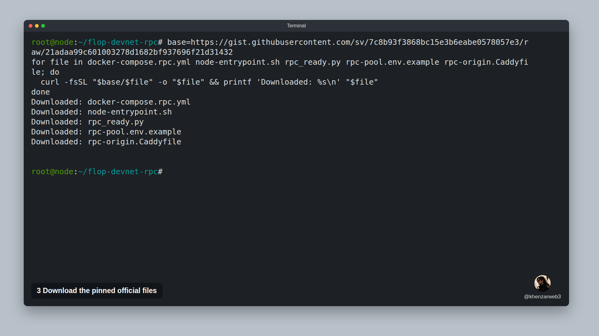
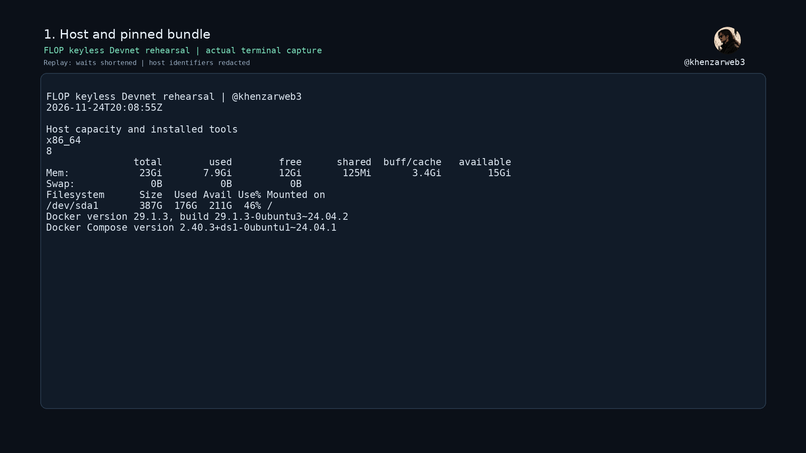
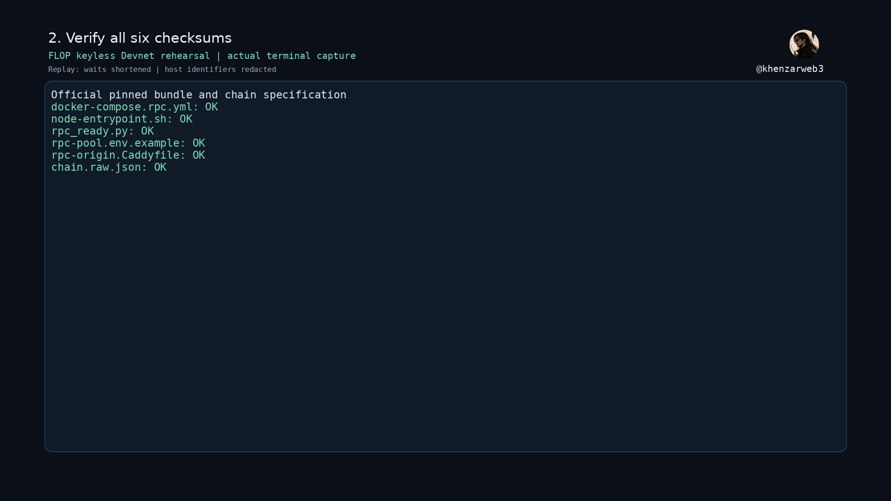
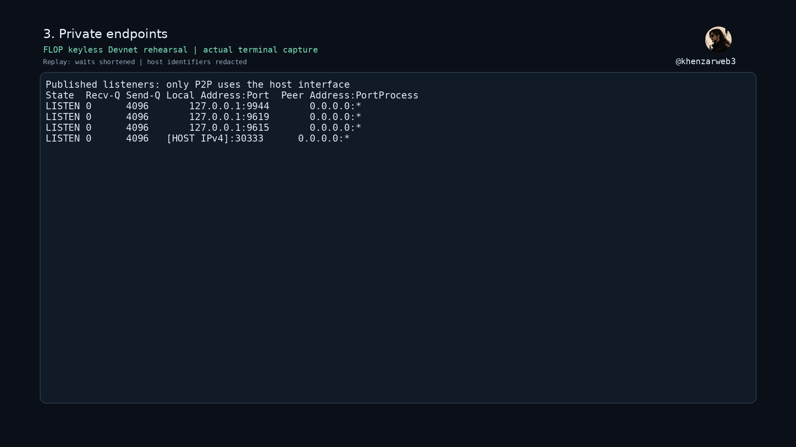
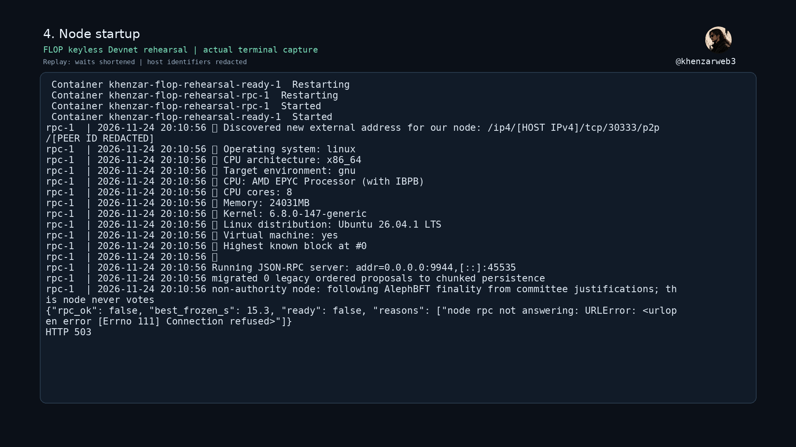
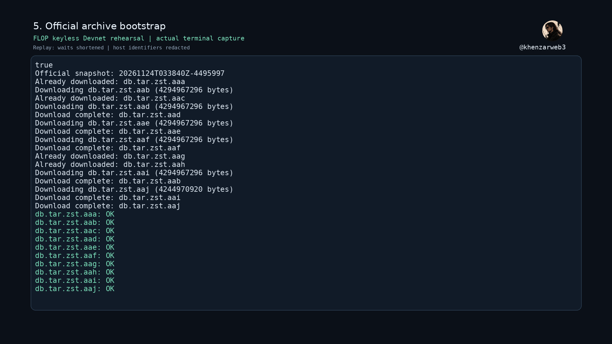
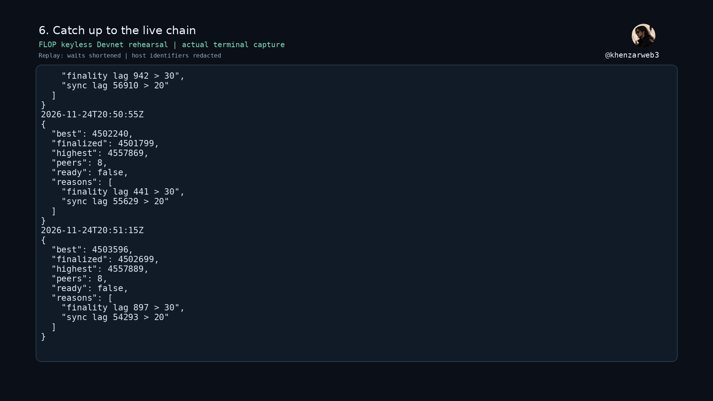
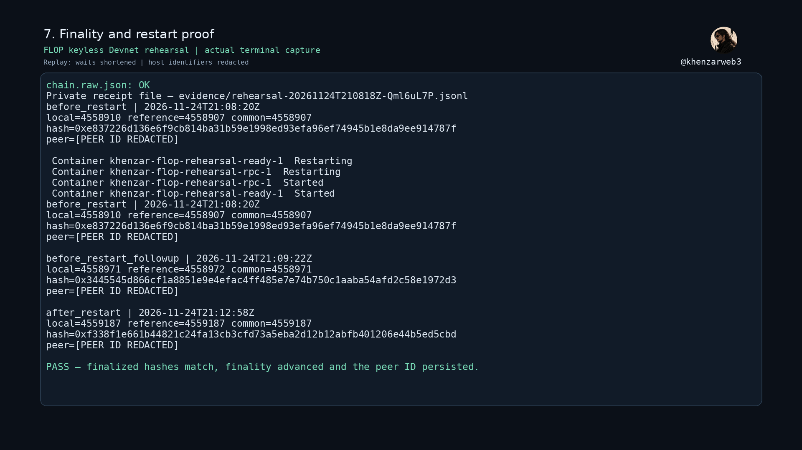
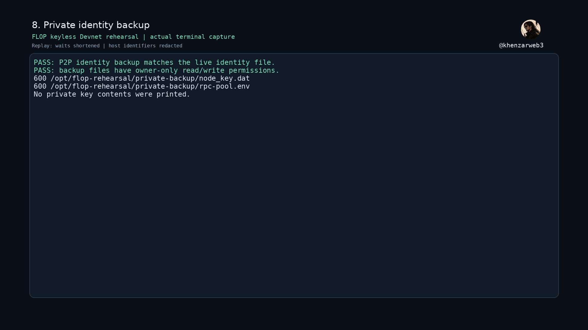

# FLOP validator prep and Devnet rehearsal

[](assets/flop-devnet-walkthrough.mp4)

**[▶ Watch the walkthrough — 1 min 27 sec](assets/flop-devnet-walkthrough.mp4)** · 12 steps · English · No audio

An independent operator guide by [@khenzarweb3](https://x.com/khenzarweb3). Register a Testnet validator candidacy, then run a FLOP Devnet observer on Linux to prove it follows finality and recovers after a restart. The observer uses no validator signing keys, stake or GPU.

FLOP's November 24, 2026 opening FAQ describes Testnet as live for unscored testing and lists the signed joining kit as pending. Registration, sponsorship, seat assignment and activation are separate steps. Check the [Testnet opening FAQ](https://docs.flop.network/docs/network-testnet) for the current release status.

> **Verified rehearsal — 24 November 2026 (UTC).** Our Contabo node passed the pinned-file checks, snapshot part checksums, finalized hash comparisons and same-volume restart test. Three observations show advancing finalized heights and the same peer ID across restart. This is a keyless Devnet rehearsal; Testnet admission and activation remain separate.

## 1. Register once for Testnet

Open the [operator application](https://github.com/flop-labs/network/issues/new?template=operator-application.yml). Select **testnet** for Network and **validator candidate** for Requested role. Include your public team name, planned host count, provider and region, preparation stage and any blockers. You can apply before the host is ready. Update an existing Testnet issue for your team and link an earlier Devnet issue when applicable.

Registration requires no payment or signature. Keep the completed host worksheet, contact details and detailed rehearsal evidence private. Request a private coordination channel in your application. [FLOP preparation kit and worksheet](https://docs.flop.network/testnet-validator-prep/)

## 2. Connect and check your host

Use a dedicated Linux host or isolated VM, and connect over SSH with `ssh USER@SERVER_IP`. Use `ssh -p PORT USER@SERVER_IP` when your provider assigned a nondefault SSH port. Confirm the machine has capacity for the archive and recovery operations. The rehearsal and production references come from FLOP.

### Requirements: rehearsal vs. Testnet validator

**For the keyless Devnet rehearsal, start with the smaller configuration below. You do not need to rent the full Testnet validator reference hardware just to complete this exercise.** FLOP lists this as an observed pilot configuration, rather than a guaranteed minimum for every host. [Official Devnet host reference](https://gist.github.com/sv/7c8b93f3868bc15e3b6eabe0578057e3)

| Resource | Rehearsal starting configuration | Testnet validator reference |
| --- | --- | --- |
| CPU | **4 vCPU**, Linux x86-64 | Linux amd64, 8 physical cores at 3.4 GHz or faster |
| Memory | **16 GiB RAM** | 32 GB ECC, 64 GB recommended |
| Storage | **300 GB SSD** starting capacity | 4 TB enterprise NVMe |
| Networking | **Stable public IPv4; inbound TCP 30333** by default | 1 Gbps symmetric, public P2P and filtered DA according to release |
| GPU | **Not needed** | Not needed |

The archive grows continuously: 300 GB is a starting capacity, not unlimited retention. On an existing server, check **available space**, not only the advertised disk size, including room for snapshot download, extraction and rollback. Check Docker's storage filesystem as well as your workspace. The Testnet preparation kit also lists Node.js 24+, Docker Engine 28+, Compose and `flock` for validator preparation.

```bash
uname -m
nproc
free -h
df -h "$HOME"
ss -ltn 'sport = :30333 or sport = :9944 or sport = :9615 or sport = :9619'
```

## 3. Prepare the command-line tools

On Ubuntu, use Docker's official APT instructions for a fresh Engine and Compose installation. Run Docker with an account already authorized to administer the local engine. [Install Docker Engine on Ubuntu](https://docs.docker.com/engine/install/ubuntu/)

```bash
sudo apt-get update && sudo apt-get install -y ca-certificates curl jq zstd
docker version --format 'Docker server {{.Server.Version}}'
docker compose version
docker_root=$(docker info --format '{{.DockerRootDir}}') && df -h "$docker_root"
```



## 4. Fetch and verify the Devnet bundle

Use a fresh project directory. This block stages the downloads and stops if any checksum fails. The six expected checksums and bundle revision are published in the [official FLOP Devnet RPC guide](https://gist.github.com/sv/7c8b93f3868bc15e3b6eabe0578057e3).

```bash
(
  set -euo pipefail
  umask 077
  destination="$HOME/flop-devnet-rehearsal"
  test ! -e "$destination"
  stage=$(mktemp -d "$HOME/.flop-devnet-rehearsal.XXXXXXXX")
  printf 'Staging in %s\n' "$stage"
  cd "$stage"

  bundle=https://gist.githubusercontent.com/sv/7c8b93f3868bc15e3b6eabe0578057e3/raw/21adaa99c601003278d1682bf937696f21d31432
  for file in docker-compose.rpc.yml node-entrypoint.sh rpc_ready.py rpc-pool.env.example rpc-origin.Caddyfile; do
    curl --fail --silent --show-error --location --output "$file" "$bundle/$file"
  done
  curl --fail --silent --show-error --location --output chain.raw.json \
    https://explorer.devnet.flop.network/validator-downloads/flop_devnet_ts-99c172c095340ace.raw.json

  sha256sum --check <<'SUMS'
6487cd84d5a257659297ad7b8fdd55978e6d8327bfe029d9460645da2591345d  docker-compose.rpc.yml
7279e81c0d6de4b6c59733b64132f929b8b7dd5825b8f37433d09940a93f983d  node-entrypoint.sh
6a066b7540628c7db4f455d7bfd2540db54355a4c0a2959d97032b76bcf641cd  rpc_ready.py
4f7295735f75b5a7b4c0babe3be4b0eef687decab99ba1612f91ee6f3b04d1bb  rpc-pool.env.example
e184d4f38f054dbe7947efde4d85e6a8964f02e594666ad42b9216dd98a4b2d5  rpc-origin.Caddyfile
3b213c38e7678285bc38fbdfded5dbe3d6acbd16e836b14aaaeef2f6ae1cd16e  chain.raw.json
SUMS
  # Public bind-mounted files must be readable by the non-root container user.
  chmod 644 chain.raw.json node-entrypoint.sh rpc_ready.py rpc-origin.Caddyfile docker-compose.rpc.yml
  cp rpc-pool.env.example rpc-pool.env
  mv -T -- "$stage" "$destination"
)
```

Continue after all six entries report `OK`. A failed attempt leaves its staging directory available for inspection.



## 5. Configure P2P without exposing RPC

```bash
cd "$HOME/flop-devnet-rehearsal"
ip -4 route get 1.1.1.1
nano rpc-pool.env
```

Set `COMPOSE_PROJECT_NAME=flop-devnet-rehearsal` once. Put the host interface's IPv4 address in `HOST_IP` and the advertised public multiaddress in `PUBLIC_ADDR` using `/ip4/YOUR_PUBLIC_IPV4/tcp/30333`. Allow inbound TCP P2P to the configured local `P2P_PORT`. For NAT, the public address or forwarded port may differ. Preserve existing SSH and firewall rules.

Keep `RPC_BIND_IP=127.0.0.1` and `PROMETHEUS_BIND_IP=127.0.0.1`. Only P2P needs an inbound rule. Confirm RPC (9944), metrics (9615) and readiness (9619) publish on loopback. Keep the pinned image, chain spec, bootnode and archive settings in the bundle. [Docker port publishing](https://docs.docker.com/engine/network/port-publishing/)



## 6. Start the keyless observer

```bash
dc() { docker compose --env-file rpc-pool.env -f docker-compose.rpc.yml "$@"; }
dc config --quiet && dc pull && dc up -d && dc ps
dc logs --tail=40 rpc
curl --silent --show-error --max-time 5 --write-out '\nHTTP %{http_code}\n' \
  http://127.0.0.1:9619/ready
```

After reconnecting, repeat the project `cd` and `dc` definition. A `503` is expected during catch-up. Check for peers and moving block imports, then wait for HTTP `200`.



## 7. Optional: download a verified archive snapshot

Direct sync from genesis is supported. A snapshot is faster but trusts FLOP's published historical database; your node only re-executes blocks after the snapshot height. Keep enough space for the compressed download, unpacked archive and old database. On our run the download was about 40 GiB; do not assume that size will stay fixed.

The following block keeps the first manifest when you resume a download. It checks the expected Devnet genesis, validates filenames, and verifies every downloaded part. It does not automatically retry errors. If the snapshot has expired, inspect the error before starting a fresh download directory.

```bash
(
  set -euo pipefail
  cd "$HOME/flop-devnet-rehearsal"
  mkdir -p seed && cd seed
  base=https://snapshots.flop.network/devnet-ts/archive
  test -s latest.json || {
    curl -fSL --connect-timeout 20 --max-time 60 "$base/latest.json" -o latest.json.tmp
    mv latest.json.tmp latest.json
  }
  jq -e '.genesis_hash == "0x99c172c095340ace980631f9123544c6bebd4839f3437e463533422d8be2d631"' latest.json
  name=$(jq -er .name latest.json)
  [[ "$name" =~ ^[A-Za-z0-9_-]+$ ]]
  jq -er '.parts[] | "\(.file) \(.bytes)"' latest.json | while read -r file bytes; do
    [[ "$file" =~ ^db\.tar\.zst\.[a-z]+$ ]]
    if [[ $(stat -c %s "$file" 2>/dev/null || echo 0) != "$bytes" ]]; then
      curl -fSL --connect-timeout 20 --max-time 1800 --continue-at - \
        "$base/$name/$file" -o "$file"
    fi
  done
  jq -r '.parts[] | "\(.sha256)  \(.file)"' latest.json > SHA256SUMS
  sha256sum --check SHA256SUMS
  jq -r '.parts[].file' latest.json | xargs cat | zstd -dc | tar -tf - > archive-paths.txt
  if grep -Eq '(^/|(^|/)\.\.(/|$))' archive-paths.txt; then
    echo 'Unsafe archive path'; exit 1
  fi
  mkdir unpack
  jq -r '.parts[].file' latest.json | xargs cat | zstd -dc | tar --no-same-owner -xf - -C unpack
  test -d unpack/full
)
```

All parts must report `OK`. Keep the snapshot's manifest: it identifies its image and height. Do not silently substitute its node image for the pinned bundle. If your node cannot open the snapshot database, stop it and restore the retained database instead of deleting your identity.



## 8. Install the snapshot with the node stopped

Skip this step when syncing from genesis. Keep the original database until readiness and the finality tests pass. The swap below changes only this Compose project's data. It checks the `/data` mount instead of assuming a volume path.

```bash
(
  set -euo pipefail
  cd "$HOME/flop-devnet-rehearsal"
  dc() { docker compose --env-file rpc-pool.env -f docker-compose.rpc.yml "$@"; }
  container=$(dc ps -q rpc)
  test -n "$container"
  data=$(docker inspect -f '{{range .Mounts}}{{if eq .Destination "/data"}}{{.Source}}{{end}}{{end}}' "$container")
  test -n "$data"
  db="$data/chains/flop_devnet_ts/db"
  sudo test -d "$db/full"
  sudo test ! -e "$db/full.from-genesis"
  test -d seed/unpack/full
  dc stop
  sudo mv "$db/full" "$db/full.from-genesis"
  sudo mv seed/unpack/full "$db/full"
  sudo chown -R --reference="$db" "$db/full"
  dc up -d
)
```

Check readiness again with the command in step 6. A snapshot close to the current head can still need time to catch up. If startup reports a database compatibility error, stop the project, move the snapshot database aside, restore `full.from-genesis` as `full`, and resume genesis sync. Keep `node_key.dat` and the network directory unchanged.



## 9. Prove finality, restart and repeat

Paste this block into Bash after readiness returns HTTP `200`. It writes three UTC-stamped observations to a private receipt. It verifies block zero on both endpoints, compares finalized hashes at the lower finalized height, and requires advancing finality and a stable peer ID across restart.

```bash
(
  set -euo pipefail
  umask 077
  cd "$HOME/flop-devnet-rehearsal"

  local_rpc=http://127.0.0.1:9944/
  reference_rpc=https://rpc.devnet.flop.network/
  ready_url=http://127.0.0.1:9619/ready
  genesis=0x99c172c095340ace980631f9123544c6bebd4839f3437e463533422d8be2d631
  image=ghcr.io/flop-labs/flop-core/node-devnet@sha256:84498fd73db2464eb13088ab34d369ddf7cddd22a45c810d140c9ff8ec16c91d
  spec=3b213c38e7678285bc38fbdfded5dbe3d6acbd16e836b14aaaeef2f6ae1cd16e

  dc() { docker compose --env-file rpc-pool.env -f docker-compose.rpc.yml "$@"; }
  rpc() {
    local payload
    payload=$(jq -cn --arg method "$2" --argjson params "$3" \
      '{jsonrpc:"2.0",id:1,method:$method,params:$params}') || return
    curl --fail --silent --show-error --max-time 15 "$1" \
      -H 'Content-Type: application/json' --data "$payload" |
      jq -er 'if .error then error(.error | tostring) else .result end'
  }
  finalized_height() {
    local head params height
    head=$(rpc "$1" chain_getFinalizedHead '[]') || return
    params=$(jq -cn --arg head "$head" '[$head]') || return
    height=$(rpc "$1" chain_getHeader "$params" | jq -er '.number') || return
    [[ $height =~ ^0x[0-9a-fA-F]+$ ]] || return 1
    printf '%d\n' "$height"
  }
  ready() { curl --fail --silent --max-time 5 "$ready_url" >/dev/null; }
  observe() {
    local phase="$1" current reference common local_hash reference_hash peer
    ready || { echo 'Observer is not ready' >&2; return 1; }
    [[ $(rpc "$local_rpc" chain_getBlockHash '[0]') == "$genesis" ]] ||
      { echo 'Unexpected local genesis' >&2; return 1; }
    [[ $(rpc "$reference_rpc" chain_getBlockHash '[0]') == "$genesis" ]] ||
      { echo 'Unexpected reference genesis' >&2; return 1; }
    current=$(finalized_height "$local_rpc") || return
    reference=$(finalized_height "$reference_rpc") || return
    common=$((current < reference ? current : reference))
    local_hash=$(rpc "$local_rpc" chain_getBlockHash "[$common]") || return
    reference_hash=$(rpc "$reference_rpc" chain_getBlockHash "[$common]") || return
    [[ $local_hash =~ ^0x[0-9a-fA-F]{64}$ && $local_hash == "$reference_hash" ]] ||
      { echo "Finalized hash mismatch at height $common" >&2; return 1; }
    peer=$(rpc "$local_rpc" system_localPeerId '[]') || return
    [[ $peer =~ ^[1-9A-HJ-NP-Za-km-z]+$ ]] || return 1
    jq -cn --arg phase "$phase" --arg utc "$(date -u +%FT%TZ)" \
      --arg genesis "$genesis" --arg image "$image" --arg spec "$spec" \
      --argjson current "$current" --argjson reference "$reference" --argjson common "$common" \
      --arg hash "$local_hash" --arg remote_hash "$reference_hash" --arg peer "$peer" \
      '{phase:$phase,utc:$utc,genesis:$genesis,image:$image,spec_sha256:$spec,
        local_finalized:$current,reference_finalized:$reference,common_height:$common,
        local_hash:$hash,reference_hash:$remote_hash,peer_id:$peer}'
  }
  require_progress() {
    printf '%s\n' "$1" "$2" | jq -es '.[1].peer_id == .[0].peer_id and
      .[1].local_finalized > .[0].local_finalized and
      .[1].common_height > .[0].common_height' >/dev/null ||
      { echo 'Finality stalled or the peer ID changed' >&2; return 1; }
  }

  printf '%s  %s\n' "$spec" chain.raw.json | sha256sum --check
  container=$(dc ps -q rpc)
  [[ -n $container && $(docker inspect --format '{{.Config.Image}}' "$container") == "$image" ]]
  mkdir -p evidence
  receipt=$(mktemp "evidence/rehearsal-$(date -u +%Y%m%dT%H%M%SZ)-XXXXXXXX.jsonl")
  printf 'Private receipt file — %s\n' "$receipt"

  first=$(observe before_restart)
  printf '%s\n' "$first"
  printf '%s\n' "$first" >> "$receipt"
  sleep 60
  second=$(observe before_restart_followup)
  printf '%s\n' "$second"
  printf '%s\n' "$second" >> "$receipt"
  require_progress "$first" "$second"

  dc restart rpc ready
  [[ $(dc ps -q rpc) == "$container" ]]
  min_common=$(jq -er '.common_height' <<< "$second")
  min_local=$(jq -er '.local_finalized' <<< "$second")
  deadline=$((SECONDS + 300))
  until ready &&
    current_local=$(finalized_height "$local_rpc") &&
    current_reference=$(finalized_height "$reference_rpc") &&
    (( current_local > min_local && current_reference > min_common )); do
    (( SECONDS < deadline )) || { echo 'Timed out waiting for recovery' >&2; exit 1; }
    sleep 5
  done

  after=$(observe after_restart)
  printf '%s\n' "$after"
  printf '%s\n' "$after" >> "$receipt"
  require_progress "$second" "$after"
  echo 'PASS — finalized hashes match, finality advanced and the peer ID persisted.'
)
```

Keep the receipt with all three observations. Reference the before/after evidence on your Testnet application once the check passes, and share detailed data privately. A healthy container alone gives no evidence of finalized agreement.



Recorded results from our own run ([full hashes and verification summary](assets/verification-summary.json)):

| Observation | UTC | Local finalized | Reference finalized | Common height |
| --- | --- | ---: | ---: | ---: |
| before_restart | 2026-11-24T21:08:20Z | 4558910 | 4558907 | 4558907 |
| before_restart_followup | 2026-11-24T21:09:22Z | 4558971 | 4558972 | 4558971 |
| after_restart | 2026-11-24T21:12:58Z | 4559187 | 4559187 | 4559187 |


## 10. Maintain the rehearsal node

- Use `dc stop` and `dc up -d` for a normal stop and resume. Retain the named volume and Compose project name.
- Never use `docker compose down -v` or volume-pruning commands on node data you intend to retain.
- Keep an encrypted backup of the private P2P identity at `/data/node_key.dat` in the node's data volume. Keep that file, the environment file, raw terminal captures and receipts out of Git. Retire the previous instance before you reuse its identity on a new host.
- If readiness stays at `503`, check `dc ps`, `dc logs --tail=80 rpc ready` and the readiness response body. Look at free disk space, bootnode connectivity and peer count.
- If hashes differ or finality stalls, stop qualification and retain the receipts and data. Compare your image, spec and reference to the official Devnet documentation before retrying.

Use FLOP's signed Testnet kit and fresh Testnet keys when the operator release becomes available. Keep Testnet and Devnet data in separate projects. [FLOP Network releases](https://github.com/flop-labs/network/releases)


## 11. Back up the private P2P identity

The peer ID belongs to a private identity file. It is not a validator session key, but it must still stay private. Run these commands on the server while you are in the project directory:

```bash
(
  set -euo pipefail
  umask 077
  dc() { docker compose --env-file rpc-pool.env -f docker-compose.rpc.yml "$@"; }
  container=$(dc ps -q rpc)
  test -n "$container"
  data=$(docker inspect -f '{{range .Mounts}}{{if eq .Destination "/data"}}{{.Source}}{{end}}{{end}}' "$container")
  test -n "$data"
  sudo test -f "$data/node_key.dat"
  backup="$HOME/flop-private-backups/$(date -u +%Y%m%dT%H%M%SZ)"
  mkdir -p "$backup"
  sudo install -m 600 -o "$(id -u)" -g "$(id -g)" "$data/node_key.dat" "$backup/node_key.dat"
  install -m 600 rpc-pool.env "$backup/rpc-pool.env"
  echo 'Private backup created; no key contents printed.'
)
```

Transfer that private backup over your authenticated SSH connection to your own encrypted storage. Keep an off-host copy. Do not upload it to GitHub, a public issue, or a recording. A backup stored only on the same VPS does not protect against loss of the VPS. Never run two live nodes with a copied identity.



### Recover the same identity on another Devnet host

Stop the old instance first. Prepare a new host with the same pinned Devnet inputs and its own correct interface/P2P configuration. Start its fresh project once to create the data volume and identity, then stop it. Copy your private backup to that host through an authenticated private channel. In the new project directory, replace **only** the generated P2P identity:

```bash
(
  set -euo pipefail
  dc() { docker compose --env-file rpc-pool.env -f docker-compose.rpc.yml "$@"; }
  backup="$HOME/flop-restored-private-backup/node_key.dat"
  test -s "$backup"
  container=$(dc ps -aq rpc)
  test -n "$container"
  dc stop
  data=$(docker inspect -f '{{range .Mounts}}{{if eq .Destination "/data"}}{{.Source}}{{end}}{{end}}' "$container")
  test -n "$data"
  sudo test -f "$data/node_key.dat"
  owner=$(sudo stat -c %u "$data/node_key.dat")
  group=$(sudo stat -c %g "$data/node_key.dat")
  sudo install -m 600 -o "$owner" -g "$group" "$backup" "$data/node_key.dat"
  dc up -d
)
```

Sync the new host and repeat step 9. Compare its Peer ID with your old private receipt before considering migration complete. This recovery procedure is separate from the recorded same-host restart test; no cross-host migration was performed for this guide. Do not reuse Devnet identities or databases as an assumed Testnet migration.

## 12. Add evidence to your application

Update the same Testnet application after the rehearsal. Keep the actual full hashes, UTC times, image digest, chain-spec checksum and unchanged peer ID in your private evidence. Follow the current form's instructions for public summaries and private coordination. Do not copy Devnet network parameters into a Testnet deployment.

Suggested public summary, to use **only after your own checks pass**:

```text
Preparation: keyless Devnet sync and restart rehearsal completed.
The local and reference genesis matched the expected Devnet genesis.
Finalized hashes matched at common heights, finality advanced, and the
peer ID persisted after restart with the same Compose project and volume.
Detailed non-secret receipts are available for operator review.
Testnet activation is pending the official signed joining kit and admission.
```

## Official references

- [Validator preparation and private host worksheet](https://docs.flop.network/testnet-validator-prep/)
- [Keyless Devnet node, pinned bundle and snapshot procedure](https://gist.github.com/sv/7c8b93f3868bc15e3b6eabe0578057e3)
- [Operator application](https://github.com/flop-labs/network/issues/new?template=operator-application.yml)
- [Operator hub](https://docs.flop.network/operators)
- [FLOP Network releases](https://github.com/flop-labs/network/releases)

Prepared independently by [@khenzarweb3](https://x.com/khenzarweb3).
